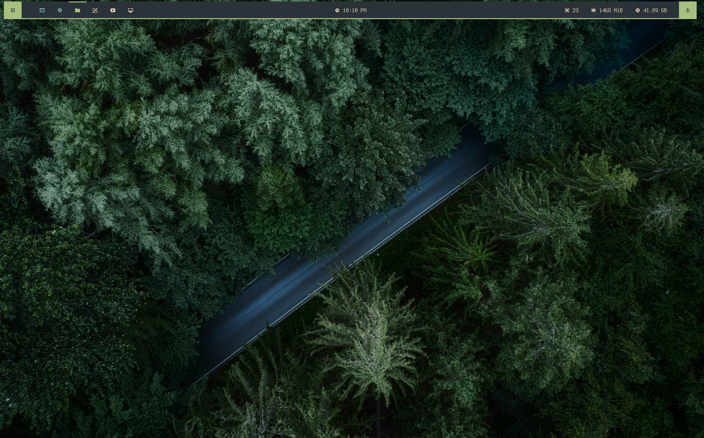
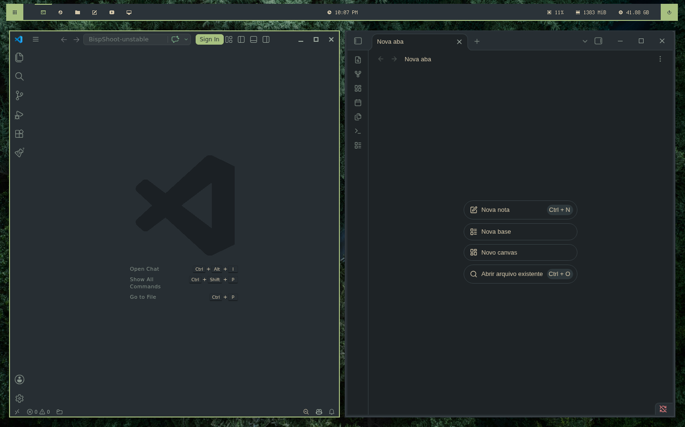
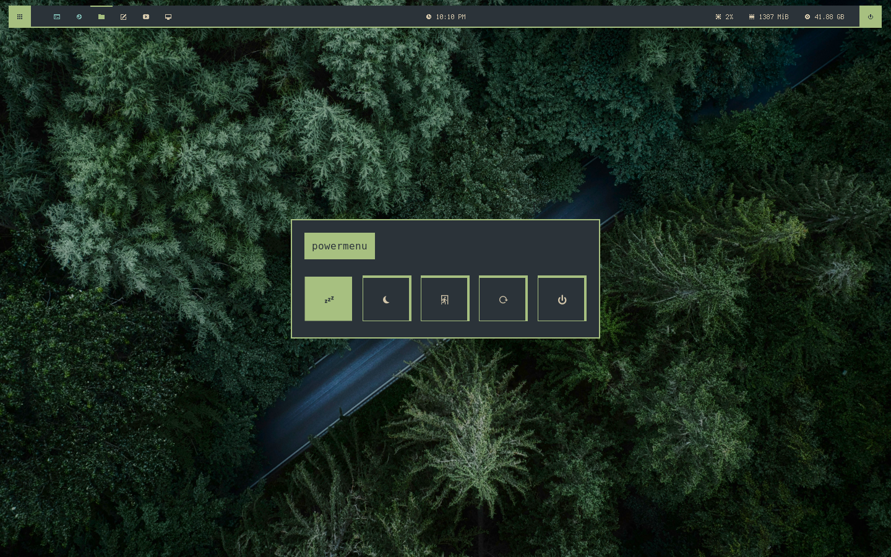
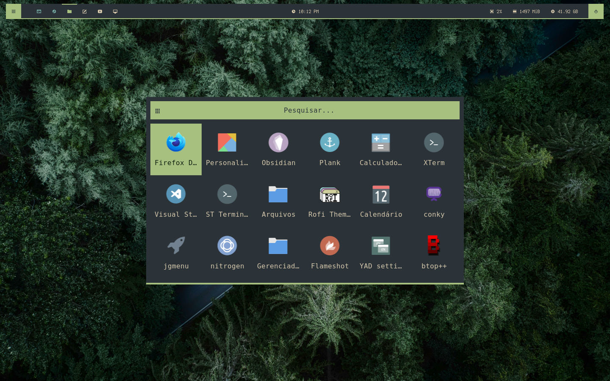
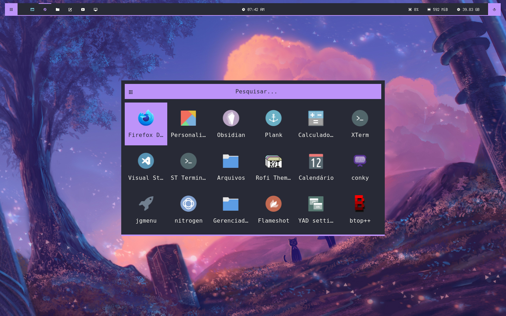
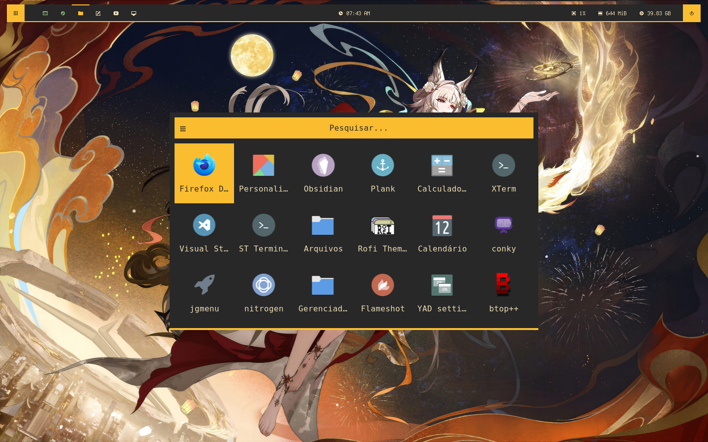
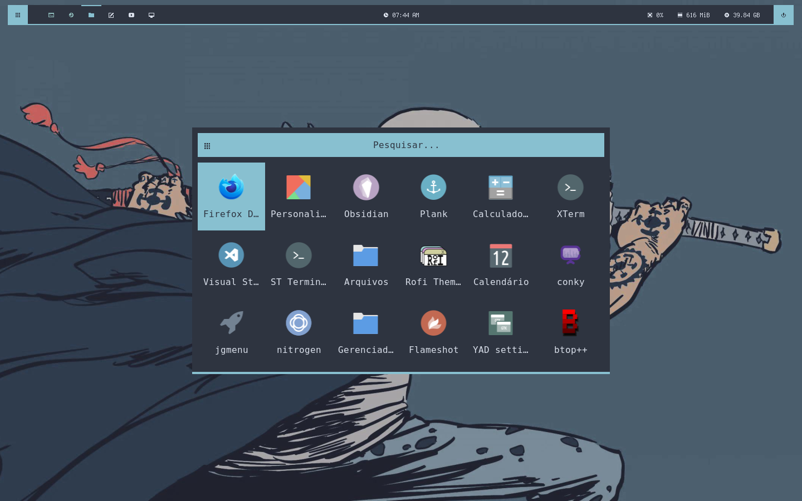
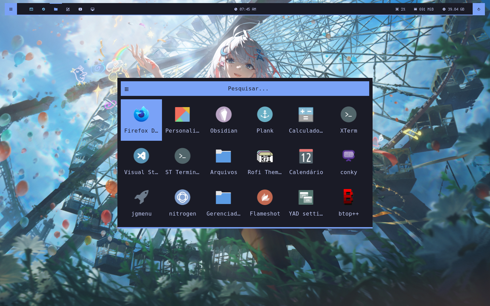

# Bispshot

> Versão 1.0 | Lançamento

# Galeria

















# Pacotes

| **WM**            | bspwm     |
| ----------------- | --------  |
| **TASKBAR**       | polybar   |
| **MENU**          | rofi      |
| **MATERIAL YOU**  | matugen   |
| **COMPOSITOR**    | xcompmgr  |
| **NOTIFICATION**  | dunst     |
| **PRINT**         | flameshot |
| **POLKIT**        | lxpolkit  |
| **HOTKEY DAEMON** | sxhkd     |
| **BG**            | feh       |
| **TERMINAL**      | st        |
| **BROWSER**       | firefox   |
| **FILE MANAGER**  | thunar    |
| **CODE EDITOR**   | code      |
| **NOTES**         | obsidian  |

> os programas de compositor, print, polkit, terminal, browser, file manager, code editor e notes podem ser trocadas atravez dos arquivos em `user/`.

dependência para scripts:

- imagemagick
- pulseaudio-ctl

fontes:

- FiraCode Nerd Font
- Terminus
- Waffle

# Instalação e Remoção

Para instalar o dotfile, use esse comando:

```bash
git clone "https://github.com/Violonista/Bispshot.git"
cd "./Bispshot"

config="${XDG_CONFIG_HOME:-$HOME/.config}"

mkdir -p "$config/old-dotfile" "$config/dunst"

[ -d "$config/bspwm" ] && mv "$config/bspwm" "$config/old-dotfile/"
[ -d "$config/dunst" ] && mv "$config/dunst" "$config/old-dotfile/"

cp -r "./config/bspwm" "$config"
chmod +x "$config/bspwm/bspwmrc"
chmod +x "$config"/bspwm/scripts/*
```

e para remover:

```bash
config="${XDG_CONFIG_HOME:-$HOME/.config}"

rm -rf "$config/bspwm"
rm -rf "$config/dunst"

mv "$config"/old-dotfile/* "$config"
```

# Features

## definições simples

Em `/user`, é onde você definira comportamentos, configurações e programas a serem usados no dotfile.

- `/user`
  - `config.sh`:
    Onde você definira o comportamento do bspwm
    (use config, ja que é a abreviação do bspc config)
  - `hotkeys`:
    Onde é o arquivo de configuração do hotkey daemon.
  - `rules.sh`:
    Onde você definira as regras das janelas do bspwm
    ( outra abreviação; rule para bspc rule -a )
  - `startup.sh`:
    Onde você definira os programas que iniciarão com o bspwm
    ( use run "comando", para notificar erros e não duplicar processos )
  - `var.sh`:
    Onde você definira variaveis tanto para o sistema, como para o bspwmrc

### Variáveis em var.sh

- **BSPWM_THEME**: define o tema a ser usado.

```bash
# mais opções em $ bspwm-material --list
export BSPWM_THEME="everforest"
```

- **BSPWM_LAYOUT**: define o layout padrão da barra e dos menus do bspwm.

```bash
# mais opções em `$ bspwm-list-layouts`
export BSPWM_LAYOUT="glayout"
```

- **BSPWM_WALLPAPER**: define o wallpaper ou com o path, ou com o nome em `resources/wallpapers`

```bash
# defina o wallpaper ou com o path, ou com o nome em `resources/wallpapers`
export BSPWM_WALLPAPER="default.jpg"
```

- **WORKSPACES**: define os workspaces e seus nomes

```bash
# defina como ( 1 2 3 4 5 6 ) ou algo do tipo
WORKSPACES=( 1 2 3 4 5 6 )
```

- **COMPOSITOR**: define o compositor a ser executado

```bash
# define o compositor a ser executado
COMPOSITOR="xcompmgr"
```

- **COMPOSITOR_ARGS**: define os argumentos que serão enviados ao compositor

```bash
# argumentos para o compositor
COMPOSITOR_ARGS=("-o" "0.9" "-D" "5" "-c" "-C" "-f" "-F")
```

- **KEYBOARD_LANG***: define o layout do teclado

```bash
KEYBOARD_LANG="br"
```

- **KEYBOARD_MODEL**: define o modelo do teclado

```bash
KEYBOARD_MODEL="abnt2"
```

- **MATERIAL_START**: define quando o material you sera executado

```bash
# define quando o material you sera executado
# opções
# startup: inicia só no inicio de sessão
# restart: inicia sempre quando atualizado o bspwm
MATERIAL_START="startup"
```

- **WALLPAPER_CONFIG**: define como sera aplicado o wallpaper

```bash
# define como sera aplicado o wallpaper
# op: scale, fill, max, center, tile
WALLPAPER_CONFIG="fill"
```

- **WALLPAPER_ARGS**: define os argumentos que serão enviados ao daemon de wallappers

```bash
# define os argumentos que serão enviados ao daemon de wallappers
WALLPAPER_ARGS=()
```

## Material you

Atravéz do bspwm-material, você pode **definir um tema ou imagem para aplicar ao material you**, sendo eles aplicados ao layout

os temas disponíveis são:

- **catppuccin**
- **dracula**
- **everforest**
- **gruvbox**
- **kanagawa**
- **nord**
- **tokyo-night**

# Hotkeys

- super + shift + t = terminal
- super + shift + b = browser
- super + shift + n = notes
- super + shift + c = code
- super + shift + f = file manager

- super + ctrl + r = recarrega bspwm
- super + ctrl + alt + r = recarrega hotkeys

- super + q = fechar a janela
- super + alt + q = forçar o fechamento da janela

- super + ctrl + t = modo tiled
- super + ctrl + alt + t = modo pseudo tiled
- super + ctrl + f = modo floating
- super + ctrl + alt + f = modo fullscreen

- super + ctrl + left = move a janela para o workspace da esquerda
- super + ctrl + right = move a janela para o workspace da direita

- super + left = troca de foco para a janela da esquerda
- super + right = troca de foco para a janela da direita
- super + up = troca de foco para a janela de cima
- super + down = troca de foco para a janela de baixo

- super + ctrl + alt + left = move a janela para esquerda
- super + ctrl + alt + right = move a janela para direita
- super + ctrl + alt + up = move a janela para cima
- super + ctrl + alt + down = move a janela para baixo

- super + {1..9,0} = move o foco para um workspace de 1 ate 10

- ctrl + alt + left = troca de foco para o workspaxe da esquerda
- ctrl + alt + right = troca de foco para o workspace da direita

- super + space = launcher
- super + p = print
- super + shift + p = powermenu
- alt + tab = janelas 

- super + ctrl + menos = diminui o tamanho da janela 
- super + ctrl + igual = aumenta o tamanho da janela

- ctrl + f2 e raiserVolume = aumenta o volume
- ctrl + f1 e lowerVolume = diminui o volume
- ctrl + f3 e audioMute = deixa o volume mudo

# Ideias para o futuro

- estou **refazendo parte do codigo do bspwmrc**, so para torna-lo mais estavel.
- estou testando o **conky**, para adicionar **widgets ao dotfile**.
- eu vou adicionar **gtk e qt ao material you** possivelmente na **proxima atualização**.
- vou fazer um **layout novo**, o qual vai ser algo agradável aos olhos. acho que um bom nome seria cozy-style.
- na proxima atualização, vou definir uma opção para o `BSPWM_THEME`, ao ser definido como WALL, use o papel de parede no material you.

# Inspirações e plágios

- **[Gh0stzk](https://github.com/gh0stzk)**: [Dotfiles](https://github.com/gh0stzk/dotfiles) (Principal inspiração)
- **[Adi1090x](https://github.com/adi1090x): [Polybar-themes](https://github.com/adi1090x/polybar-themes) [Rofi](https://github.com/adi1090x/rofi)** (tema docky & launcher)
- **[owl4ce](https://github.com/owl4ce)**: [Dotfiles](https://github.com/owl4ce/dotfiles)

# Licença

Este projeto é distribuído sob a licença **GPL-3.0**. Veja o arquivo [LICENSE](LICENSE) para mais detalhes.

Partes deste dotfile são baseadas ou adaptadas de projetos também licenciados sob GPL:

- [gh0stzk/dotfiles](https://github.com/gh0stzk/dotfiles)
- [adi1090x/polybar-themes](https://github.com/adi1090x/polybar-themes) e [adi1090x/rofi](https://github.com/adi1090x/rofi)
- [owl4ce/dotfiles](https://github.com/owl4ce/dotfiles)

Todas as imagens criados neste projeto, foram criadas por **Violonista**, dono do projeto, e licenciados sob GPL-3.0 como o restante do projeto.
